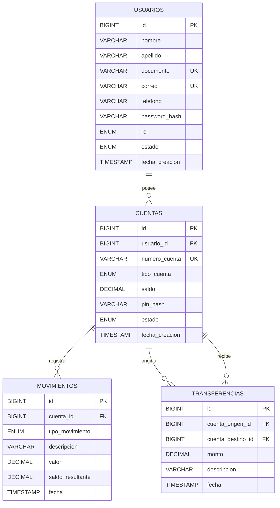

# Simulador Bancario Web

Aplicación académica que integra tres módulos bancarios sobre una base de datos MySQL: banca virtual de clientes, panel administrativo y cajero automático virtual. Las operaciones financieras se reflejan entre módulos mediante una API REST protegida con JWT.

## Módulos y funciones

- **Banca virtual:** consulta de perfil, cuentas, saldos e historial; actualización de datos permitidos; cambio de contraseña; transferencias entre cuentas activas con validación de fondos y doble movimiento.
- **Panel administrativo:** cuatro métricas; creación y gestión de clientes y cuentas; búsqueda, detalle, edición y estados; consulta de cuentas y movimientos; consignaciones.
- **Cajero automático:** acceso con cuenta y PIN, consulta de saldo, últimos movimientos, retiros y cierre de operación.

## Tecnologías

- Node.js, Express y JavaScript.
- MySQL con `mysql2/promise` y pool de conexiones.
- HTML5, CSS3, JavaScript y Bootstrap 5.
- `bcrypt` para contraseñas y PIN; `jsonwebtoken` para sesiones y autorización por rol.

## Estructura

```text
backend/
  src/config/         Conexión MySQL y configuración JWT
  src/controllers/    Validación y respuestas HTTP
  src/middlewares/    Autenticación JWT y autorización
  src/models/         Consultas y transacciones MySQL
  src/routes/         Rutas REST
  .env.example        Plantilla de configuración
frontend/
  index.html          Portal y vistas de los tres módulos
  styles.css          Estilos adaptables
  config.js           URL configurable de la API
  app.js              Interacción con la API mediante fetch
database.sql          Esquema y datos de prueba
docs/diagrama-bd.md   Diagrama entidad-relación
```

## Requisitos previos

- Node.js 18 o superior y npm.
- MySQL 8 o MariaDB compatible con restricciones `CHECK`.
- Navegador moderno.
- Para servir el frontend localmente: Python 3 o la extensión Live Server de VS Code.

## Instalación y ejecución local

1. Instala dependencias y crea tu archivo local de entorno:

   ```powershell
   cd backend
   npm install
   Copy-Item .env.example .env
   ```

2. Edita `backend/.env` con las credenciales de MySQL. Configura `JWT_SECRET` con un secreto aleatorio de al menos 32 caracteres. El archivo `.env` no debe subirse al repositorio.

3. Importa `database.sql` una vez. Desde una terminal con el cliente MySQL disponible:

   ```powershell
   Get-Content .\database.sql -Raw | mysql -u root -p
   ```

   El script crea y selecciona `simulador_bancario`. En phpMyAdmin, importa el archivo desde la pestaña **Importar**.

4. Inicia el backend en una terminal nueva:

   ```powershell
   cd backend
   npm start
   ```

   El puerto predeterminado es `3000` (se puede cambiar con `PORT`). Comprueba la API y MySQL en `http://localhost:3000/api/health`; debe responder `200` con `{"status":"ok","database":"connected"}`.

5. En otra terminal nueva, publica el frontend desde la raíz del repositorio:

   ```powershell
   cd frontend
   python -m http.server 5500
   ```

   Abre `http://localhost:5500`. Alternativamente, abre `frontend/index.html` con Live Server.

## Configuración de API y despliegue

La URL está centralizada en `frontend/config.js`:

```js
window.APP_CONFIG = Object.freeze({
  API_BASE_URL: 'http://localhost:3000/api',
});
```

Antes de publicar, cambia ese valor por `'/api'` si el dominio sirve frontend y API detrás de un proxy inverso del mismo origen, o por la URL HTTPS de la API si usa otro dominio. Si frontend y API tienen orígenes distintos, configura `CORS_ORIGIN` en `backend/.env` con el origen exacto del frontend; para más de uno, sepáralos con comas. Usa HTTPS, un `JWT_SECRET` propio y credenciales de base de datos con privilegios limitados. No publiques el `.env` ni uses las credenciales semilla en producción.

Variables documentadas en `backend/.env.example`:

| Variable | Uso |
|---|---|
| `NODE_ENV` | Entorno de ejecución |
| `PORT` | Puerto HTTP del backend (predeterminado `3000`) |
| `CORS_ORIGIN` | Origen(es) autorizado(s) del frontend |
| `DB_HOST`, `DB_PORT`, `DB_USER`, `DB_PASSWORD`, `DB_NAME` | Conexión a MySQL |
| `DB_CONNECTION_LIMIT` | Límite del pool MySQL |
| `JWT_SECRET`, `JWT_EXPIRES_IN` | Firma y duración de sesiones JWT |

## Usuarios de prueba

Los hashes bcrypt de contraseñas y PIN están en `database.sql`; las credenciales en texto plano para iniciar sesión son:

| Rol | Correo | Contraseña | Cuenta | PIN cajero |
|---|---|---|---|---|
| Administrador | `admin@bancario.com` | `Admin123!` | — | — |
| Cliente | `ana.garcia@bancario.com` | `Cliente123!` | `1000000001` | `1234` |
| Cliente | `bruno.martinez@bancario.com` | `Cliente123!` | `1000000002` | `2345` |
| Cliente | `carla.rodriguez@bancario.com` | `Cliente123!` | `1000000003` | `3456` |

## API REST

Todas las rutas están bajo `http://localhost:3000/api`. Las rutas protegidas reciben `Authorization: Bearer <JWT>`.

| Método | Ruta | Acceso | Función |
|---|---|---|---|
| `GET` | `/health` | Público | Estado de API y conexión MySQL |
| `POST` | `/auth/login` | Público | Login de cliente o administrador por correo y contraseña |
| `POST` | `/auth/cajero-login` | Público | Login ATM por cuenta y PIN |
| `GET`, `PUT` | `/cliente/perfil` | CLIENTE | Consultar y actualizar perfil |
| `PUT` | `/cliente/password` | CLIENTE | Cambiar contraseña |
| `GET` | `/cliente/cuenta`, `/cliente/cuentas` | CLIENTE | Consultar cuenta(s) propias |
| `GET` | `/cliente/movimientos` | CLIENTE | Historial propio paginado |
| `POST` | `/cliente/transferencias` | CLIENTE | Transferencia atómica y doble movimiento |
| `GET` | `/admin/dashboard` | ADMIN | Métricas generales |
| `GET`, `POST` | `/admin/clientes` | ADMIN | Buscar/listar y crear cliente con cuenta |
| `GET`, `PUT`, `PATCH` | `/admin/clientes/:id` | ADMIN | Detalle, edición y cambio de estado (`PATCH /:id/estado`) |
| `GET` | `/admin/cuentas`, `/admin/movimientos` | ADMIN | Consultas generales paginadas |
| `POST` | `/admin/consignaciones` | ADMIN | Consignar y registrar movimiento |
| `GET` | `/cajero/saldo`, `/cajero/movimientos` | ATM | Saldo y últimos movimientos de la sesión ATM |
| `POST` | `/cajero/retiros` | ATM | Retirar y registrar movimiento |

## Verificación integral de Fase 7

Con la base importada y backend activo, realiza este flujo con las credenciales de prueba:

1. Comprueba `GET /api/health` y verifica que MySQL responda conectado.
2. Inicia sesión como administrador y consulta `GET /api/admin/dashboard` para ver las cuatro métricas.
3. Consulta `GET /api/admin/cuentas` y `GET /api/admin/movimientos`.
4. Inicia sesión en el cajero con la cuenta `1000000001` y PIN `1234`; consulta saldo y movimientos.
5. Retira un monto de prueba, por ejemplo `1000`, desde el cajero.
6. Consulta de nuevo el saldo y los movimientos del cajero; debe aparecer el retiro.
7. Inicia sesión en Banca Virtual como Ana y confirma el saldo menor y el mismo movimiento en su historial.
8. En el Panel Administrativo, vuelve a cargar cuentas y movimientos; confirma que reflejan el retiro.
9. Consigna `1000` a la cuenta `1000000001`; vuelve a Banca Virtual y verifica el saldo actualizado y el nuevo movimiento de consignación.

Las operaciones de prueba escriben movimientos en la base de datos. Los movimientos financieros son inmutables; importa de nuevo la semilla solo en una base de datos de prueba que pueda reinicializarse.

## Diagrama entidad-relación



## Alcance y seguridad

Los datos de cliente se aíslan por usuario; los campos financieros y de autorización no se editan desde el perfil del cliente. La API valida montos positivos, estados activos, fondos suficientes y roles. No se incluyen productos de crédito, pagos de servicios, transferencias interbancarias, biometría ni integraciones con bancos reales.
