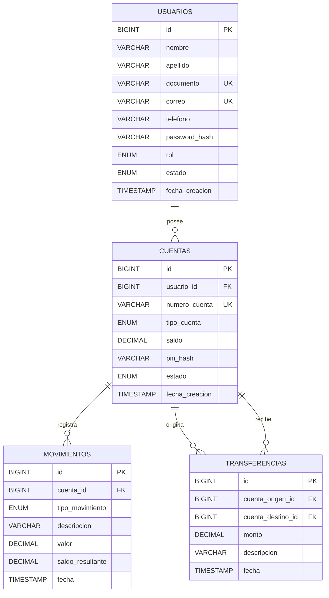

# Diagrama entidad-relación

El modelo utiliza claves foráneas restrictivas para conservar clientes, cuentas y movimientos financieros. Una cuenta pertenece a un usuario; cada movimiento pertenece a una cuenta; cada transferencia relaciona una cuenta origen y una cuenta destino.

El esquema ejecutable y sus restricciones están en [`../database.sql`](../database.sql).
